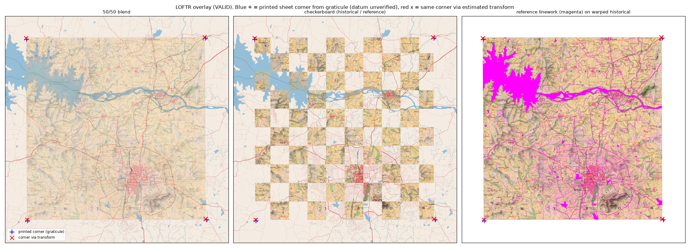

# MapAlign

**Feature-Based Georeferencing of Historical Survey of India Maps: A Reproducible Baseline Comparison**

MapAlign compares three ways of aligning a 1926 Survey of India topographic sheet (57 D/11, Mysore) with a modern
geographic reference:
- **Method A:** learned feature matching (Kornia LoFTR + RANSAC);
- **Method B:** classical feature matching (OpenCV SIFT + RANSAC);
- **Method C:** a least-squares fit to manually selected ground-control points (GCPs).

Every method is scored by one shared evaluation on the same held-out control points, as positional error in metres.

This is an engineering benchmark on **one** map sheet, not a claim of methodological novelty.

> **Read before using the numbers.** All 21 control points (9 fitting, 12 evaluation) were picked by an AI assistant
> (Claude) from zoomed image crops, and were then **reviewed by a human (Saksham Sharma, 2026-10-19), who made no
> changes**. Only **12** held-out points could be established (the target was 20), and none lie in the southern fifth
> of the sheet or in Mysore city. See [Limitations](#limitations).

## Contents
[Research question](#research-question) · [Motivation](#motivation) · [Data and licensing](#data-and-licensing) ·
[Architecture](#system-architecture) · [Methods](#methods-compared) · [Installation](#installation) ·
[Data preparation](#data-preparation) · [Running](#running-the-experiment) · [GCP collection](#gcp-collection) ·
[Coordinate conventions](#coordinate-conventions) · [Metrics](#evaluation-metrics) · [Figures](#example-visualizations) ·
[Results](#results) · [Limitations](#limitations) · [Reproducibility](#reproducibility) · [Citation](#citation-and-acknowledgements)

## Research question

How do learned feature matching, classical feature matching, and manual GCP georeferencing compare in positional
accuracy, robustness, and computational cost when aligning a historical topographic map with a modern geographic
reference?

## Motivation

Tens of thousands of colonial-era Survey of India sheets have been scanned and released openly, but few are
georeferenced. Manual georeferencing is slow, and it is hard to find control points that survive a century of change.
Learned matchers such as LoFTR promise to automate this, but cross-era map matching is very different from the photo
pairs they were trained on. MapAlign measures, under one fixed protocol, how well each approach actually does on a
real sheet.

## Data and licensing

| Role | Source | Licence |
|---|---|---|
| Historical map | Survey of India 1-inch sheet **57 D/11 "Mysore"**, surveyed 1924–25, published 1926, 1:63,360, neatline 76°30′–76°45′E, 12°15′–12°30′N; 5898 × 6828 px, 300 dpi JPEG. [Zenodo record 8388121](https://zenodo.org/records/8388121), compiled by John Brown | CC BY 4.0 (deposit). The underlying 1926 Government of India work is believed to be out of copyright (not legal advice) |
| Modern reference | OpenStreetMap roads, railways, waterways, water bodies and landmarks; one Overpass API query for the sheet bbox plus a 0.03° margin; rendered locally to a GeoTIFF in EPSG:32643 at 5 m | © OpenStreetMap contributors, [ODbL](https://opendatacommons.org/licenses/odbl/) |

- **Not committed:** raw data. `python -m mapalign.fetch all` re-downloads it, checks the MD5 published by Zenodo, and
  records SHA-256 checksums and the OSM snapshot timestamp in `data/raw/manifest.json`.
- **Source verification:** [`data/SOURCES.md`](data/SOURCES.md) records how the sheet was chosen and its metadata.
- **Excluded data:** the Survey of India Open Series (2011+) sheets are © Government of India ("reproduction
  prohibited"). They are **not used and must not be added** to this repository.

## System architecture

```
Zenodo scan ──► preprocess (crop to neatline, resample to 10 m) ──┐
                                                                  ├─► matcher (SIFT | LoFTR) ─► shared RANSAC ─► H (hist px → ref px)
OSM Overpass ─► render GeoTIFF (EPSG:32643, 5 m) ─────────────────┘                                           │
                                                                                                               ▼
OSM vectors ─► candidate GCPs ─► manual picking ─► least-squares H (Method C) ─────────────────────► georeference ─► GeoTIFF
                                        └─► held-out evaluation points (locked by SHA-256) ─► shared evaluation (metres)
```

```
configs/experiment.yaml   paths, source metadata, CRSs, all parameters (frozen 2026-10-19)
data/                     raw/ and processed/ (git-ignored) + manifest.json + SOURCES.md
gcp/                      fitting_points.csv, evaluation_points.csv, candidates.csv, PROTOCOL.md, thumbnails
src/mapalign/             config, io, fetch, reference (OSM render), preprocess, match_sift, match_loftr,
                          estimate_transform, diagnostics, pipeline, gcp, georeference, evaluate, visualize,
                          envcheck, run_all
tests/                    pytest suite (53 tests)
notebooks/                01_matching_baselines.ipynb (exploration only; it reads saved results)
results/                  metrics, per-point errors, run records, figures (GeoTIFFs are git-ignored)
paper/writeup.md          technical report
```

## Methods compared

All three methods produce a 3 × 3 projective homography mapping **historical-scan pixels → reference pixels**. The
reference's exact affine geotransform then gives EPSG:32643 metres.

| | Method A: LoFTR + RANSAC | Method B: SIFT + RANSAC | Method C: manual GCPs |
|---|---|---|---|
| Correspondences | Kornia `LoFTR(pretrained="outdoor")`. Both images scaled by one common factor to ≤ 768 px (≈ 45 m/px), eval mode, no grad | OpenCV SIFT on 10 m/px grayscale; brute-force L2 2-NN matching; Lowe ratio 0.75 | 9 picked GCPs, of which 2 were removed by a pre-fit QC rule, leaving 7 |
| Estimator | MAGSAC (OpenCV USAC), 3 px at the matcher's resolution, 1.2 M iterations, seed 42 | same | least squares, no RANSAC |
| Automatic? | yes | yes | human-assisted (here: AI-assisted) |

Transform validity checks shared by all methods: finite entries, conditioning, orientation, anisotropy, the horizon
line, a convex mapped outline, and plausible bounds.

## Installation

### Windows (tested: Windows 11, Python 3.12.12)

With [uv](https://docs.astral.sh/uv/):

```powershell
git clone <repo-url> MapAlign; cd MapAlign
uv venv .venv --python 3.12
uv pip install --python .venv\Scripts\python.exe torch==2.14.1 --index-url https://download.pytorch.org/whl/cpu
uv pip install --python .venv\Scripts\python.exe -r requirements.txt
uv pip install --python .venv\Scripts\python.exe -e . --no-deps
.venv\Scripts\Activate.ps1
```

With plain pip, run `py -3.12 -m venv .venv`, then run the same three installs with `.venv\Scripts\python.exe -m pip install ...`.

**GPU (optional):** install the CUDA torch wheel instead, e.g. `--index-url https://download.pytorch.org/whl/cu126`;
it needs about 5 GB of disk. All reported results were produced on CPU.

### Google Colab

```python
!git clone <repo-url> MapAlign
%cd MapAlign
!pip install -q -e ".[dev]"        # keeps Colab's CUDA torch
!python -m mapalign.run_all
```

### Verify

```powershell
python -m mapalign.envcheck    # expect 4 PASS lines (SIFT+RANSAC, LoFTR, pyproj, rasterio) and "0 failed"
python -m pytest -q            # expect "53 passed"
```

## Data preparation

```powershell
python -m mapalign.fetch all     # scan (MD5-checked), OSM features, OSM landmarks
python -m mapalign.reference     # OSM -> data/processed/osm_57D11_utm43n.tif (EPSG:32643, 5 m)
```

`fetch` sends one Overpass query per extract. It does not download map tiles, in line with the
[OSM tile policy](https://operations.osmfoundation.org/policies/tiles/). Re-fetching gives a *newer* OSM snapshot. For
an exact reproduction, keep the original extract; its SHA-256 is in `data/raw/manifest.json`.

## Running the experiment

The whole experiment, in order (about 5 minutes on CPU after the data is fetched; the raster and verification steps take most of it):

```powershell
python -m mapalign.run_all
```

Individual steps:

```powershell
python -m mapalign.pipeline sift              # Method B (exit code 2 = ran, no valid transform)
python -m mapalign.pipeline loftr             # Method A
python -m mapalign.georeference datum         # graticule offset + fitting-point QC
python -m mapalign.georeference manual        # Method C
python -m mapalign.georeference raster loftr  # georeferenced GeoTIFF (also: manual)
python -m mapalign.georeference verify loftr  # file-level checks + OSM vector overlay figure
python -m mapalign.evaluate                   # held-out evaluation (refuses to run if the config is unfrozen or the points changed)
python -m mapalign.gpu_check                  # in a CUDA environment: rerun LoFTR on the GPU into results/gpu/ and compare
```

Development-only exploration (it never touches evaluation points):
- `python -m mapalign.diagnostics sift-variants`
- `python -m mapalign.diagnostics loftr-sizes`

**QGIS check:** load `results/georef_loftr.tif` or `georef_manual.tif` (EPSG:32643), then add *XYZ Tiles → OpenStreetMap*
for on-screen comparison. The alpha band masks everything outside the neatline. *(This check was not performed for the
reported results; see Limitations.)*

## GCP collection

The full protocol, fixed before any evaluation, is in [`gcp/PROTOCOL.md`](gcp/PROTOCOL.md).

1. **Candidates** (`python -m mapalign.gcp candidates`): about 1,050 points computed from OSM *vector geometry*:
   exact railway×road, road×water and railway×water intersections, major-road junctions, stations, and landmarks.
   Their EPSG:32643 coordinates are the **truth**.
2. **Picking aids:**
   - `gcp sheet <ids>` shows the 1926 crop beside the OSM render;
   - `gcp zoom x,y` shows a fine crop with a 10 px grid.

   Crops are centred using only the sheet's printed corners, never a method's transform.
3. **Acceptance:** the feature must exist in 1926 with the same geometry and be locatable to about ±5 px (±27 m).
   Post-1926 canals and roads, realigned lines and ambiguous junctions are rejected.
4. **Spatial design:** a 5 × 5 grid over the neatline. Evaluation points must lie ≥ 1 km from every fitting point.
5. **Pre-use QC (method-independent):** reject or re-examine a point whose offset from the printed graticule is more
   than 3 robust σ from the median.
6. **Lock** (`python -m mapalign.gcp lock`): the SHA-256 of `evaluation_points.csv` is stored in `data/raw/manifest.json`.

To re-pick points as a human: edit the CSVs, keeping column units. Then re-lock with `python -m mapalign.gcp lock --force`,
which re-runs the QC and stores the new hash. Then run `mapalign.run_all`. Record the revision in
`PROTOCOL.md`.

CSV columns (units in the names): `point_id, historical_x_px, historical_y_px, reference_x_px, reference_y_px,
true_easting_m, true_northing_m, crs, feature_type, truth_source, confidence, valid_for_evaluation, exclusion_reason, notes`.

## Coordinate conventions

- **Chain:** historical full-res px →(H)→ reference GeoTIFF px →(affine geotransform)→ EPSG:32643 m.
- **Pixels:** `(x, y)` = (column, row), at the centre of the top-left pixel = (0, 0) (OpenCV), in the
  **original full-resolution files**. Working-resolution coordinates are converted with explicit 3 × 3 matrices.
- **Evaluation CRS:** WGS 84 / UTM 43N (EPSG:32643). At the sheet, UTM distance differs from geodesic distance by
  < 0.01 % (8 cm over 10 km, checked in `envcheck`). Degrees and pixels are never used as distances.
- **Historical graticule:** the printed latitude/longitude is on an unverified pre-WGS84 Indian (Kalianpur) datum. It is
  offset from WGS84 by about (−84 m E, +53 m N), measured from the fitting GCPs. It is used only for diagnostics, never
  as truth.
- **GeoTIFF output:** a north-up EPSG:32643 grid at 5 m. Each output pixel is sampled through the *exact inverse*
  homography, so the projective transform is never approximated by the affine geotransform.

## Evaluation metrics

For each held-out point *i*: eᵢ = √((Eᵢ − Êᵢ)² + (Nᵢ − N̂ᵢ)²) in EPSG:32643 metres.

**Reported:** mean, median, RMSE (√mean eᵢ²), max, min, population std, 90th percentile, number of valid points,
failed predictions, runtime, and for the automatic methods the proposed matches, RANSAC inliers and inlier ratio.

**Paired comparison** (same points):
- exact two-sided Wilcoxon signed-rank test;
- percentile bootstrap 95 % CI of the median paired difference (20,000 resamples, seed 42).

**Kept separate from the positional error:**
- *Fitting error:* Method C residuals at its own fitting points, plus leave-one-out residuals.
- *Automatic-match reprojection error:* image-space RMSE of RANSAC inliers.

The **positional error at held-out points** is the primary result.

## Example visualizations

All figures below are generated from the measured runs.

| | |
|---|---|
|  LoFTR correspondences (green = RANSAC inlier) |  SIFT correspondences: no consistent model |
|  1926 map warped onto the OSM render (LoFTR) |  OSM vectors drawn on the LoFTR GeoTIFF |
|  Held-out error vectors, LoFTR |  Per-point errors, LoFTR vs manual |

## Results

Positional error at **12 held-out points** (EPSG:32643, metres; homography model):

| Method | Status | n | Median | Mean | RMSE | Max | Min | Std | P90 | Runtime (CPU) |
|---|---|---|---|---|---|---|---|---|---|---|
| SIFT + RANSAC | **failed**: 594 matches, 26 degenerate inliers | 0 / 12 | – | – | – | – | – | – | – | ≈ 15 s |
| **LoFTR + RANSAC** | valid: 601 matches, 389 inliers (64.7 %) | 12 | **53.9** | 64.2 | **77.4** | 191.7 | 24.2 | 43.3 | 95.9 | ≈ 20 s |
| Manual GCPs | valid: 7 fitting points (fit RMSE 55.6 m, leave-one-out RMSE 146.9 m) | 12 | 73.9 | 89.6 | 102.4 | 223.9 | 44.9 | 49.5 | 140.6 | 0.15 s fit* |

\* Human interaction time is not reported, because the points were picked by an AI assistant.
Exact runtimes per run are in `results/*_run.json`.

**Paired comparison, LoFTR vs manual:**
- LoFTR was more accurate at 9 of 12 points.
- Median paired difference: −31.7 m.
- Exact Wilcoxon p = 0.043.
- Bootstrap 95 % CI of the median difference: [−44.0, +2.5] m.

This is weak evidence, from 12 points on one sheet.

**Affine vs homography** (secondary; not used to choose any setting):
- LoFTR affine: median 42.4 m, RMSE 76.3 m.
- Manual affine: median 87.8 m, RMSE 105.5 m.

The extra projective freedom gives no measurable gain on this sheet.

**Why SIFT failed:** even on tiles already aligned by the printed sheet corners, only 4.75 % of SIFT matches are correct,
against a chance level of 4.31 %. Eight preprocessing variants did not help.

**Failure cases:**
- **E11** (low confidence) is about 200 m off for both methods, in the same direction. The likely cause is
  mis-identification or road realignment. The point is kept in the results.
- Manual errors in the north-east point consistently south, consistent with its sparse fitting layout.

**Sensitivity check, without the 3 low-confidence points** (context only):

| Method | Median | RMSE |
|---|---|---|
| LoFTR | 44.9 m | 46.0 m |
| Manual | 66.7 m | 86.1 m |

Full numbers: `results/metrics.json`, `metrics.csv`, `evaluation_errors.csv`.

**GPU check** (`results/gpu/gpu_check.json`). LoFTR was rerun on an RTX 3050 Laptop GPU (CUDA 12.6) with the same
frozen settings. It found the same 601 matches and 389 inliers. Inference took 1.8 s on the GPU, against 8.0 s on the
CPU. Floating-point differences between the devices shift the transform by 1.9 m on average (8.5 m at most) across the
sheet. The held-out RMSE is 77.2 m on the GPU vs 77.4 m on the CPU. The reported results are the CPU run. Each device is
deterministic on its own.

## Limitations

- **One sheet, one OSM rendering style.** Nothing here generalises to "LoFTR is better for historical maps".
- **AI-picked, human-reviewed GCPs** for both the manual baseline and the ground truth. The review accepted every pick
  unchanged. The manual baseline is still "AI-picked, human-reviewed GCPs", not independent human georeferencing, and
  no human interaction time exists to report.
- **12 evaluation points, not 20, with no coverage of the south or of Mysore city.** That area is mostly
  extrapolation for every method.
- **Truth accuracy:** OSM geometry has unknown accuracy (plausibly 5–20 m). Point-picking adds roughly ±5 px (±27 m).
- **Tuning on development data:** three settings were changed during development: LoFTR input size, RANSAC
  iterations, and the threshold rule. All were justified on development data only and frozen before the evaluation
  points existed. They are still choices made after seeing the first failures.
- **Datum:** the 1926 datum is not identified. PROJ has no real Kalianpur 1880 → WGS84 transformation.
- **Not done:** a visual check in QGIS (not installed on the development machine).

## Reproducibility

- **Determinism:** the complete pipeline was re-run from the raw data, and every transform matrix, per-point error and
  metric was reproduced exactly (timings differ).
- **Environment:** pinned versions in `requirements.txt`; hardware/software in `results/environment.json` and
  `results/experiment_metadata.json`; seed 42.
- **Input checksums:** in `configs/experiment.yaml` and `data/raw/manifest.json`.
- **Frozen configuration:** frozen 2026-10-19. `mapalign.evaluate` refuses to run if the configuration is unfrozen or
  `evaluation_points.csv` has changed.

## Citation and acknowledgements

See [`CITATION.cff`](CITATION.cff). Report: [`paper/writeup.md`](paper/writeup.md).

- **Map scan:** Old Survey of India Maps collection (J. Brown, Zenodo, CC BY 4.0); the scan bears a University of
  Michigan Library stamp.
- **Modern data:** © OpenStreetMap contributors (ODbL).
- **Software:** Kornia LoFTR (Sun et al., CVPR 2021) and OpenCV SIFT (Lowe, IJCV 2004).
- **Assistance:** much of the code and all GCP picks were produced with an AI assistant (Claude, Anthropic); the GCPs
  were reviewed by Saksham Sharma.

**Licence:** code under MIT (see `LICENSE`); data under their own licences.
