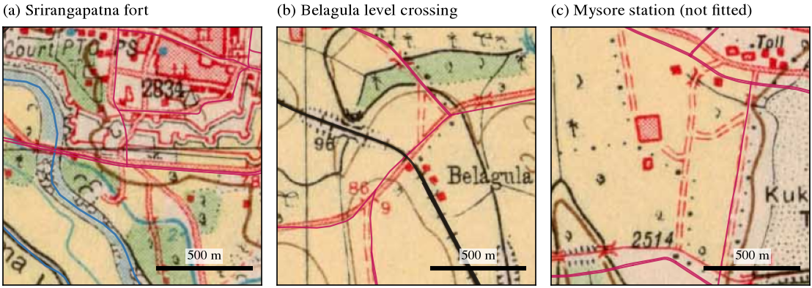

# MapAlign

**Feature-Based Georeferencing of Historical Survey of India Maps: A Reproducible Baseline Comparison**

[](https://doi.org/10.5281/zenodo.23572419)



MapAlign compares three ways of aligning a 1926 Survey of India topographic sheet (57 D/11, Mysore) with a modern
geographic reference:
- **Method A:** learned feature matching (Kornia LoFTR + RANSAC);
- **Method B:** classical feature matching (OpenCV SIFT + RANSAC);
- **Method C:** a least-squares fit to manually selected ground-control points (GCPs).

Every method is scored by one shared evaluation on the same held-out control points, as positional error in metres.

This is an engineering benchmark on **one** map sheet, not a claim of methodological novelty.

**Paper:** [*Georeferencing a 1926 Survey of India Sheet: Learned Matching, Classical Matching and Manual Control Points Compared on Held-Out Ground Truth*](paper/mapalign.pdf) (PDF, 14 pages; LaTeX source in `paper/`)  
**Interactive report:** https://mysore-1926.pages.dev  
**Archive:** Zenodo, [doi:10.5281/zenodo.23572419](https://doi.org/10.5281/zenodo.23572419) (all versions; v1.0.0 is [doi:10.5281/zenodo.23572420](https://doi.org/10.5281/zenodo.23572420))

> **Read before using the numbers.** All 21 control points (9 fitting, 12 evaluation) were picked by an AI assistant
> (Claude) from zoomed image crops, and were then **reviewed by a human (Saksham Sharma, 2026-10-19), who made no
> changes**. Only **12** held-out points could be established (the target was 20), and none lie in the southern fifth
> of the sheet or in Mysore city. A later blind, timed human re-pick is reported separately
> ([Re-picking](#re-picking-the-control-points)); it does not replace these points. See [Limitations](#limitations).

## Contents
[Research question](#research-question) · [Motivation](#motivation) · [Data and licensing](#data-and-licensing) ·
[Architecture](#system-architecture) · [Methods](#methods-compared) · [Installation](#installation) ·
[Data preparation](#data-preparation) · [Running](#running-the-experiment) · [GCP collection](#gcp-collection) ·
[Coordinate conventions](#coordinate-conventions) · [Metrics](#evaluation-metrics) · [Figures](#example-visualizations) ·
[Results](#results) · [Robustness](#robustness-and-sensitivity) · [Other matchers and models](#other-matchers-and-transform-models) ·
[Re-picking](#re-picking-the-control-points) · [Related work](#related-work) · [Limitations](#limitations) · [Reproducibility](#reproducibility) · [Citation](#citation-and-acknowledgements)

## Research question

How do learned feature matching, classical feature matching, and manual GCP georeferencing compare in positional
accuracy, robustness, and computational cost when aligning a historical topographic map with a modern geographic
reference?

## Motivation

Tens of thousands of colonial-era Survey of India sheets have been scanned and released openly, but few are
georeferenced. Manual georeferencing is slow, and it is hard to find control points that survive a century of change.
Learned matchers such as LoFTR promise to automate this, but cross-era map matching is very different from the photo
pairs they were trained on. MapAlign measures, under one fixed protocol, how well each approach actually does on a
real sheet.

## Data and licensing

| Role | Source | Licence |
|---|---|---|
| Historical map | Survey of India 1-inch sheet **57 D/11 "Mysore"**, surveyed 1924–25, published 1926, 1:63,360, neatline 76°30′–76°45′E, 12°15′–12°30′N; 5898 × 6828 px, 300 dpi JPEG. [Zenodo record 8388121](https://zenodo.org/records/8388121), compiled by John Brown | CC BY 4.0 (deposit). The underlying 1926 Government of India work is believed to be out of copyright (not legal advice) |
| Modern reference | OpenStreetMap roads, railways, waterways, water bodies and landmarks; one Overpass API query for the sheet bbox plus a 0.03° margin; rendered locally to a GeoTIFF in EPSG:32643 at 5 m | © OpenStreetMap contributors, [ODbL](https://opendatacommons.org/licenses/odbl/) |

- **Exact inputs are versioned:** the scan and both OSM extracts are in `data/raw/`, byte-identical to the SHA-256
  checksums in `data/raw/manifest.json`, with licences in [`data/raw/ATTRIBUTION.md`](data/raw/ATTRIBUTION.md).
  `python -m mapalign.fetch all` verifies them and does not overwrite them. Re-downloading OSM would give a newer
  snapshot and different truth coordinates.
- **Source verification:** [`data/SOURCES.md`](data/SOURCES.md) records how the sheet was chosen and its metadata.
- **Excluded data:** the Survey of India Open Series (2011+) sheets are © Government of India ("reproduction
  prohibited"). They are **not used and must not be added** to this repository.

## System architecture

```
Zenodo scan ──► preprocess (crop to neatline, resample to 10 m) ──┐
                                                                  ├─► matcher (SIFT | LoFTR) ─► shared RANSAC ─► H (hist px → ref px)
OSM Overpass ─► render GeoTIFF (EPSG:32643, 5 m) ─────────────────┘                                           │
                                                                                                               ▼
OSM vectors ─► candidate GCPs ─► manual picking ─► least-squares H (Method C) ─────────────────────► georeference ─► GeoTIFF
                                        └─► held-out evaluation points (locked by SHA-256) ─► shared evaluation (metres)
```

```
configs/experiment.yaml   paths, source metadata, CRSs, all parameters (frozen 2026-10-19)
data/                     raw/ (versioned inputs) and processed/ (git-ignored) + manifest.json + SOURCES.md
docs/DECISIONS.md         every design decision, with the reason for it
gcp/                      fitting_points.csv, evaluation_points.csv, candidates.csv, PROTOCOL.md, thumbnails,
                          repick_kit_fitting|evaluation|extra/ (blind re-pick kits)
src/mapalign/             config, io, fetch, reference (OSM render), preprocess, match_sift, match_loftr,
                          estimate_transform, diagnostics, pipeline, gcp, georeference, evaluate, visualize,
                          envcheck, run_all; post hoc: robustness, robustness_extra, match_lightglue,
                          extensions, picktool, pickweb
tests/                    pytest suite (64 tests)
notebooks/                01_matching_baselines.ipynb (exploration only; it reads saved results)
results/                  metrics, per-point errors, run records, figures (GeoTIFFs are git-ignored)
paper/                    research paper: mapalign.tex, mapalign.pdf, refs.bib, figures/, tables/,
                          make_figures.py (regenerates every figure and table from results/)
site/                     static report website (deployed to Cloudflare Pages)
```

## Methods compared

All three methods produce a 3 × 3 projective homography mapping **historical-scan pixels → reference pixels**. The
reference's exact affine geotransform then gives EPSG:32643 metres.

| | Method A: LoFTR + RANSAC | Method B: SIFT + RANSAC | Method C: manual GCPs |
|---|---|---|---|
| Correspondences | Kornia `LoFTR(pretrained="outdoor")`. Both images scaled by one common factor to ≤ 768 px (≈ 45 m/px), eval mode, no grad | OpenCV SIFT on 10 m/px grayscale; brute-force L2 2-NN matching; Lowe ratio 0.75 | 9 picked GCPs, of which 2 were removed by a pre-fit QC rule, leaving 7 |
| Estimator | MAGSAC++ (OpenCV USAC), 3 px at the matcher's resolution, 1.2 M iterations, deterministic* | same | least squares, no RANSAC |
| Automatic? | yes | yes | human-assisted (here: AI-assisted) |

\* The configuration sets seed 42, but OpenCV's flag-based USAC call ignores `cv2.setRNGSeed` and always uses its
internal random state (0). Results are deterministic. A 200-seed analysis (see [Robustness](#robustness-and-sensitivity))
shows how much they would vary.

Transform validity checks shared by all methods: finite entries, conditioning, orientation, anisotropy, the horizon
line, a convex mapped outline, and plausible bounds.

## Installation

### Windows (tested: Windows 11, Python 3.12.12)

With [uv](https://docs.astral.sh/uv/):

```powershell
git clone https://github.com/1sakshm/MapAlign.git MapAlign; cd MapAlign
uv venv .venv --python 3.12
uv pip install --python .venv\Scripts\python.exe torch==2.14.1 --index-url https://download.pytorch.org/whl/cpu
uv pip install --python .venv\Scripts\python.exe -r requirements.txt
uv pip install --python .venv\Scripts\python.exe -e . --no-deps
.venv\Scripts\Activate.ps1
```

With plain pip, run `py -3.12 -m venv .venv`, then run the same three installs with `.venv\Scripts\python.exe -m pip install ...`.

**GPU (optional):** install the CUDA torch wheel instead, e.g. `--index-url https://download.pytorch.org/whl/cu126`;
it needs about 5 GB of disk. All reported results were produced on CPU.

### Google Colab

```python
!git clone https://github.com/1sakshm/MapAlign.git MapAlign
%cd MapAlign
!pip install -q -e ".[dev]"        # keeps Colab's CUDA torch
!python -m mapalign.run_all
```

### Verify

```powershell
python -m mapalign.envcheck    # expect 4 PASS lines (SIFT+RANSAC, LoFTR, pyproj, rasterio) and "0 failed"
python -m pytest -q            # expect "64 passed"
```

## Data preparation

```powershell
python -m mapalign.fetch all     # scan (MD5-checked), OSM features, OSM landmarks
python -m mapalign.reference     # OSM -> data/processed/osm_57D11_utm43n.tif (EPSG:32643, 5 m)
```

`fetch` sends one Overpass query per extract. It does not download map tiles, in line with the
[OSM tile policy](https://operations.osmfoundation.org/policies/tiles/). Re-fetching gives a *newer* OSM snapshot. For
an exact reproduction, keep the original extract; its SHA-256 is in `data/raw/manifest.json`.

## Running the experiment

The whole experiment, in order (about 5 minutes on CPU after the data is fetched; the raster and verification steps take most of it):

```powershell
python -m mapalign.run_all
```

Individual steps:

```powershell
python -m mapalign.pipeline sift              # Method B (exit code 2 = ran, no valid transform)
python -m mapalign.pipeline loftr             # Method A
python -m mapalign.georeference datum         # graticule offset + fitting-point QC
python -m mapalign.georeference manual        # Method C
python -m mapalign.georeference raster loftr  # georeferenced GeoTIFF (also: manual)
python -m mapalign.georeference verify loftr  # file-level checks + OSM vector overlay figure
python -m mapalign.evaluate                   # held-out evaluation (refuses to run if the config is unfrozen or the points changed)
python -m mapalign.gpu_check                  # in a CUDA environment: rerun LoFTR on the GPU into results/gpu/ and compare
```

Development-only exploration (it never touches evaluation points):
- `python -m mapalign.diagnostics sift-variants`
- `python -m mapalign.diagnostics loftr-sizes`

**QGIS check** (`tools/qgis_check.py`, run with QGIS's own Python, e.g. `"D:\QGIS\QGIS 3.44.14\bin\python-qgis-ltr.bat" tools\qgis_check.py`).
The script uses no MapAlign code. In QGIS 3.44.14 LTR it opens both GeoTIFFs, loads the raw OSM railways, rivers and major roads
in WGS 84 and lets QGIS reproject them, overlays the 12 held-out points and each method's predictions, and renders the sheet and
one 700 m window per point (`results/qgis/`). Results:
- QGIS reads the same CRS (EPSG:32643), extent, size and 5 m pixel size that the pipeline wrote, for both files.
- All 12 truth points fall inside the georeferenced data.
- In every window, the 1926 feature sits under the method's predicted position, offset from the OSM truth by the reported
  error. At E11 the 1926 and OSM roads coincide, but the picked junction lies about 190 m along the road from the OSM
  junction. This is consistent with a mis-identified or moved junction, not a method failure.

To inspect the files by hand, load `results/georef_loftr.tif` or `georef_manual.tif` in QGIS, then add *XYZ Tiles →
OpenStreetMap* for comparison. The alpha band masks everything outside the neatline.

## GCP collection

The full protocol, fixed before any evaluation, is in [`gcp/PROTOCOL.md`](gcp/PROTOCOL.md).

1. **Candidates** (`python -m mapalign.gcp candidates`): about 1,050 points computed from OSM *vector geometry*:
   exact railway×road, road×water and railway×water intersections, major-road junctions, stations, and landmarks.
   Their EPSG:32643 coordinates are the **truth**.
2. **Picking aids:**
   - `gcp sheet <ids>` shows the 1926 crop beside the OSM render;
   - `gcp zoom x,y` shows a fine crop with a 10 px grid.

   Crops are centred using only the sheet's printed corners, never a method's transform.
3. **Acceptance:** the feature must exist in 1926 with the same geometry and be locatable to about ±5 px (±27 m).
   Post-1926 canals and roads, realigned lines and ambiguous junctions are rejected.
4. **Spatial design:** a 5 × 5 grid over the neatline. Evaluation points must lie ≥ 1 km from every fitting point.
5. **Pre-use QC (method-independent):** reject or re-examine a point whose offset from the printed graticule is more
   than 3 robust σ from the median.
6. **Lock** (`python -m mapalign.gcp lock`): the SHA-256 of `evaluation_points.csv` is stored in `data/raw/manifest.json`.

To re-pick points as a human: edit the CSVs, keeping column units. Then re-lock with `python -m mapalign.gcp lock --force`,
which re-runs the QC and stores the new hash. Then run `mapalign.run_all`. Record the revision in
`PROTOCOL.md`.

CSV columns (units in the names): `point_id, historical_x_px, historical_y_px, reference_x_px, reference_y_px,
true_easting_m, true_northing_m, crs, feature_type, truth_source, confidence, valid_for_evaluation, exclusion_reason, notes`.

## Building the paper

```powershell
python paper/make_figures.py      # figures, tables and numbers.json from results/
cd paper; latexmk -pdf mapalign.tex
```

## Report website

`site/` holds the static website published at https://mysore-1926.pages.dev, built from the results in `results/`.
To redeploy it: `npx wrangler@4 pages deploy site --project-name mysore-1926 --branch main`.

## Coordinate conventions

- **Chain:** historical full-res px →(H)→ reference GeoTIFF px →(affine geotransform)→ EPSG:32643 m.
- **Pixels:** `(x, y)` = (column, row), at the centre of the top-left pixel = (0, 0) (OpenCV), in the
  **original full-resolution files**. Working-resolution coordinates are converted with explicit 3 × 3 matrices.
- **Evaluation CRS:** WGS 84 / UTM 43N (EPSG:32643). At the sheet, UTM distance differs from geodesic distance by
  < 0.01 % (8 cm over 10 km, checked in `envcheck`). Degrees and pixels are never used as distances.
- **Historical graticule:** the printed latitude/longitude is on an unverified pre-WGS84 Indian (Kalianpur) datum. It is
  offset from WGS84 by about (−84 m E, +53 m N), measured from the fitting GCPs. It is used only for diagnostics, never
  as truth.
- **GeoTIFF output:** a north-up EPSG:32643 grid at 5 m. Each output pixel is sampled through the *exact inverse*
  homography, so the projective transform is never approximated by the affine geotransform.

## Evaluation metrics

For each held-out point *i*: eᵢ = √((Eᵢ − Êᵢ)² + (Nᵢ − N̂ᵢ)²) in EPSG:32643 metres.

**Reported:** mean, median, RMSE (√mean eᵢ²), max, min, population std, 90th percentile, number of valid points,
failed predictions, runtime, and for the automatic methods the proposed matches, RANSAC inliers and inlier ratio.

**Paired comparison** (same points):
- exact two-sided Wilcoxon signed-rank test;
- percentile bootstrap 95 % CI of the median paired difference (20,000 resamples, seed 42).

**Kept separate from the positional error:**
- *Fitting error:* Method C residuals at its own fitting points, plus leave-one-out residuals.
- *Automatic-match reprojection error:* image-space RMSE of RANSAC inliers.

The **positional error at held-out points** is the primary result.

## Example visualizations

All figures below are generated from the measured runs.

| | |
|---|---|
|  LoFTR correspondences (green = RANSAC inlier) |  SIFT correspondences: no consistent model |
|  1926 map warped onto the OSM render (LoFTR) |  OSM vectors drawn on the LoFTR GeoTIFF |
|  Held-out error vectors, LoFTR |  Per-point errors, LoFTR vs manual |

## Results

Positional error at **12 held-out points** (EPSG:32643, metres; homography model):

| Method | Status | n | Median | Mean | RMSE | Max | Min | Std | P90 | Runtime (CPU) |
|---|---|---|---|---|---|---|---|---|---|---|
| SIFT + RANSAC | **failed**: 594 matches, 26 degenerate inliers | 0 / 12 | – | – | – | – | – | – | – | ≈ 15 s |
| **LoFTR + RANSAC** | valid: 601 matches, 389 inliers (64.7 %) | 12 | **53.9** | 64.2 | **77.4** | 191.7 | 24.2 | 43.3 | 95.9 | ≈ 20 s |
| Manual GCPs | valid: 7 fitting points (fit RMSE 55.6 m, leave-one-out RMSE 146.9 m) | 12 | 73.9 | 89.6 | 102.4 | 223.9 | 44.9 | 49.5 | 140.6 | 0.15 s fit* |

\* The original points were picked by an AI assistant, so they have no human interaction time. The later blind human
re-pick took 150 s for the 9 fitting points and 121 s for the 12 evaluation points (median 9–12 s per point).
Exact runtimes per run are in `results/*_run.json`.

**Paired comparison, LoFTR vs manual:**
- LoFTR was more accurate at 9 of 12 points.
- Median paired difference: −31.7 m.
- Exact Wilcoxon p = 0.043.
- Bootstrap 95 % CI of the median difference: [−44.0, +2.5] m.

This is suggestive, not established: the interval includes zero, and none of the secondary LoFTR-vs-manual tests
survives a multiple-testing correction (see [Robustness](#robustness-and-sensitivity)).

**Affine vs homography** (secondary; not used to choose any setting):
- LoFTR affine: median 42.4 m, RMSE 76.3 m.
- Manual affine: median 87.8 m, RMSE 105.5 m.

The extra projective freedom gives no measurable gain on this sheet.

**Why SIFT failed:** even on tiles already aligned by the printed sheet corners, only 4.75 % of SIFT matches are correct,
against a chance level of 4.31 %. Eight preprocessing variants did not help.

**Failure cases:**
- **E11** (low confidence) is about 200 m off for both methods, in the same direction. The likely cause is
  mis-identification or road realignment. The point is kept in the results.
- Manual errors in the north-east point consistently south, consistent with its sparse fitting layout.

**Sensitivity check, without the 3 low-confidence points** (context only):

| Method | Median | RMSE |
|---|---|---|
| LoFTR | 44.9 m | 46.0 m |
| Manual | 66.7 m | 86.1 m |

Full numbers: `results/metrics.json`, `metrics.csv`, `evaluation_errors.csv`.

**GPU check** (`results/gpu/gpu_check.json`). LoFTR was rerun on an RTX 3050 Laptop GPU (CUDA 12.6) with the same
frozen settings. It found the same 601 matches and 389 inliers. Inference took 1.8 s on the GPU, against 8.0 s on the
CPU. Floating-point differences between the devices shift the transform by 1.9 m on average (8.5 m at most) across the
sheet. The held-out RMSE is 77.2 m on the GPU vs 77.4 m on the CPU. The reported results are the CPU run. Each device is
deterministic on its own.

## Robustness and sensitivity

These checks were added after the held-out evaluation. None of them changed a parameter or a reported number.
Outputs are in `results/robustness/`, and they are reproduced with:

```powershell
python -m mapalign.robustness all          # seeds, confidence, intervals, spatial, landmarks, shared source, style, projection, scan, datum, timing
python -m mapalign.robustness_extra all    # synthetic benchmark, plates, symbols, thresholds, classical baselines, manual models, multiple testing
```

| Question | Result |
|---|---|
| How much error do the matchers themselves add? | On an image warped by a known transform and matched against itself: LoFTR 2.0–3.3 m RMSE, SIFT 0.2 m. The 77 m real-pair error therefore comes mostly from the map, a century of change, OSM and picking. |
| Is SIFT just a bad matcher? | No. It is the more precise matcher on same-style pairs; it fails only across the 1926-lithograph-vs-vector-render gap. |
| Confidence intervals (bootstrap) | LoFTR median 53.9 m [37.8, 70.6], RMSE 77.4 [46.8, 109.9]. Manual median 73.9 [51.7, 102.3], RMSE 102.4 [68.8, 137.6]. |
| RANSAC seed (200 seeds) | LoFTR always valid, 389–390 inliers; RMSE 76.2–77.4 m in 90 % of seeds, one outlier at 95.3 m. SIFT never valid. |
| OSM rendering style (6 variants) | LoFTR RMSE 75.2–91.9 m, never fails; removing minor roads hurts most. |
| LoFTR confidence threshold | Keeping matches ≥ 0.3 gives median 37.5 m; ≥ 0.8 gives RMSE 98.0 m. The frozen choice (keep all) was not changed. |
| Does LoFTR win by matching the truth features? | No. Removing all its matches within 1 / 2 / 3 km of each test point: RMSE 77.4 / 78.4 / 80.6 m. |
| Spatial correlation | Moran's I: none (p = 0.20–0.92). A cluster bootstrap (8 clusters) gives a median difference of −31.7 m [−44.0, −2.0]; a cluster sign-flip test gives p = 0.070. |
| Landmark definitions | Without the two landmark-centroid points: LoFTR 49.2 m vs manual 65.4 m median, p = 0.049. |
| Multiple testing (23 secondary tests, including the extensions and the human re-pick below) | Holm / Benjamini–Hochberg: LoFTR vs printed corners survives (Holm p = 0.012), and so does LoFTR vs the manual fit rebuilt from the human re-pick (Holm p = 0.012 and 0.032). No test against the original manual fit does (q = 0.07–0.14). |
| Classical baselines | Printed sheet corners alone: median 169.8 m, RMSE 173.3. Corners + ECC image alignment: median 99.5 m, RMSE 119.7 (LoFTR closer at 9 of 12, p = 0.021, Holm 0.38). |
| Fairer tuning for the manual fit | Choosing its model by leave-one-out on its own points picks a similarity transform: median 90.2 m, RMSE 106.2 m. |
| Hand-picked development thresholds | Size rule picks 768 px at every radius from 0.5 to 2 km. LoFTR beats chance on aligned tiles at every radius (1.7–14×); SIFT stays at 1.0–1.5×. |
| Projection (polyconic vs UTM) | One homography absorbs it to within 0.46 m. |
| Scan geometry | Neatline straight to 0.4–1.4 px RMS; 0.4 % scale difference between directions (absorbed by the fit); JPEG quality ≈ 79. |
| Colour-plate registration | Tint plate within 1 px east–west and about 1.7 px (≈ 9 m) north–south of the black plate. Line plates can't be measured. |
| Cartographic displacement | Road bands 35 m wide (0.55 mm), railways 10 m. Where they run closer than 27.5 m, one is displaced 12–25 m (28 of 550 samples). |
| Datum | Graticule offset (−84, +53) m from fitting points; (−105, +105) m from the 12 evaluation points. |
| Repeated timing (5 warm runs) | LoFTR 6.5 s, SIFT 7.2 s, manual fit 0.002 s. Human picking time was not recorded. |

## Other matchers and transform models

Two more questions, answered after the evaluation under the same rules as the original methods (settings chosen on
development data by a rule written down first, then scored once on the 12 locked points). Outputs are in
`results/extensions/`; design choices are logged in [`docs/DECISIONS.md`](docs/DECISIONS.md).

```powershell
python -m mapalign.extensions all    # DISK / ALIKED + LightGlue, polynomial and thin-plate-spline models
```

**Is LoFTR special?** LightGlue was paired with two learned keypoint detectors (Kornia implementations, 4096
keypoints), feeding the frozen MAGSAC++ estimator. The input size was chosen by LoFTR's Phase 4 rule (most matches
within 1 km of the printed-corner prior).

| Matcher | Input | Matches / inliers | Median | RMSE | vs LoFTR |
|---|---|---|---|---|---|
| LoFTR (frozen) | 768 px | 601 / 389 | 53.9 m | 77.4 m | – |
| ALIKED + LightGlue | 1024 px | 604 / 216 | 54.6 m | 104.9 m | LoFTR closer at 8 of 12, p = 0.15 |
| DISK + LightGlue | 768–2048 px | 0–2 / – | failed | failed | – |

DISK finds the right local matches when the tiles are already aligned (53 % correct vs 4.3 % chance, better than
LoFTR's 12.9 %), but not the global correspondence. ALIKED collapses above 1024 px, the same scale sensitivity LoFTR
shows. So LoFTR is not the only learned matcher that crosses the style gap, but it was the more reliable one.

**Does the homography limit accuracy?** No. Second- and third-order polynomials and thin-plate splines (seven
smoothing values) were fitted to LoFTR's 390 inlier matches and chosen by 4 × 4 spatial-block cross-validation, and to
the 7 manual points and chosen by leave-one-out. Both rules picked **affine** (held-out RMSE 78.5 m from LoFTR's
matches, 105.5 m from the manual points). A cubic polynomial reached 170.6 m and an unsmoothed spline 160.8 m. On this
sheet the limit is the content and a century of change, not the transform family.

## Re-picking the control points

The control points were proposed with AI assistance and reviewed, unchanged, by the author. After every other
analysis was complete, the author re-picked all of them blind and timed with `mapalign.pickweb`: the window was
centred on the printed-corner estimate, never on an earlier pick. Results are in
`results/robustness/picker_agreement.json` and `results/robustness/extra_points.json`, and in Section 8 of the paper.

| Re-pick | Result (median / RMSE in m on the 12 held-out points) |
|---|---|
| Evaluation pixels (12 points, 121 s) | the two pickers differ by a median 7.3 px (≈ 39 m); 10 of 12 within 20 px, E04 58 px, E12 76 px |
| … frozen transforms rescored | LoFTR 50.8 / 146.2, manual 106.9 / 175.0; LoFTR closer at 9 of 12 (p = 0.027) |
| Manual refitted on the re-picked GCPs (9 points, 150 s) | QC removed F02 only, 8 points used: 123.7 / 151.2 (original fit: 73.9 / 102.4); LoFTR closer at **12 of 12** (p = 0.0005, Holm 0.012) |
| … fully human (re-picked GCPs and evaluation pixels) | manual 142.4 / 208.9, LoFTR 50.8 / 146.2; LoFTR closer at 11 of 12 (p = 0.0015, Holm 0.032) |
| Supplementary points (57, in the 15 empty cells) | LoFTR 232.0 / 421.9, manual 230.1 / 418.7; no difference (p = 0.38) |
| … the 39 marked confident | LoFTR 122.4 / 299.6, manual 165.6 / 310.0; LoFTR closer at 22 of 39 (p = 0.13) |

Two things follow. A manual homography from a handful of points is fragile: the same person clicking the same features
blind moved its median error from 74 to 124 m, while LoFTR does not depend on the clicks at all. And the supplementary
points do **not** measure accuracy in the south. None of the 57 was skipped. The two transforms never disagree by
more than 155 m on them, yet at 21 points both are more than 300 m off, and at five more than 800 m. At those points
the 1926 feature that was clicked is not the OSM feature, either because a look-alike nearby was clicked or because
the feature postdates the sheet. The file is hashed and kept as recorded. The kit instructions now say to skip unless
sure.

To repeat the re-pick with another picker, everything is in the repository:

| Kit | Points | Purpose |
|---|---|---|
| `gcp/repick_kit_fitting/` | 9 | re-pick Method C's fitting points; Method C is refitted with the frozen QC rule |
| `gcp/repick_kit_evaluation/` | 12 | re-pick the historical pixel of every evaluation point (truth stays OSM) |
| `gcp/repick_kit_extra/` | 57 candidates | new evaluation points in the 15 grid cells that have none, including the south and Mysore city; skip any feature that is not on the 1926 sheet |

Kits are centred with the printed-corner prior only and contain no existing pick. The timed picking tool shows the
1926 scan next to the OSM target, records the click in full-resolution pixels and the seconds spent, and saves after
every point, so a session can be resumed:

```powershell
python -m mapalign.picktool gcp/repick_kit_fitting/repick_fitting_template.csv --picker "Your Name"
python -m mapalign.picktool gcp/repick_kit_evaluation/repick_evaluation_template.csv --picker "Your Name"
python -m mapalign.picktool gcp/repick_kit_extra/repick_extra_template.csv --picker "Your Name"
# or all three kits in the browser, on localhost only:
python -m mapalign.pickweb --picker "Your Name"     # http://127.0.0.1:8765

python -m mapalign.robustness picker --fitting gcp/repick_kit_fitting/repick_fitting_template.csv `
                                     --repick  gcp/repick_kit_evaluation/repick_evaluation_template.csv
python -m mapalign.robustness extra_points --points gcp/repick_kit_extra/repick_extra_template.csv
```

`picker` reports the picker-to-picker distance per point, refits Method C on the human picks, scores everything on the
original and on the re-picked evaluation pixels, and gives the human interaction time. `extra_points` scores the
frozen transforms on the new points, alone, pooled with the original 12 and restricted to points marked confident, and
records the file's SHA-256. The original analysis and its lock are not touched; the AI-assisted run stays the primary
result.

## Related work

- **Vaienti, di Lenardo and Kaplan (2025)**, *Georeferencing historical maps using local feature matching and
  Delaunay consistency*, Cartography and Geographic Information Science
  ([doi:10.1080/15230406.2025.2566789](https://doi.org/10.1080/15230406.2025.2566789)). They transfer georeferencing
  from georeferenced maps of Jerusalem to new ones with SuperPoint + SuperGlue, RANSAC and a Delaunay-consistency
  filter, and find that about 100 matched keypoints separate reliable from unreliable results. LoFTR here keeps 389.
- **Petitpierre, Jan and Guhennec (2026)**, *JADIS SuperMapRealigner: A Generic Method for the Automatic Alignment of
  Historical Maps*, software ([doi:10.5281/zenodo.19821751](https://doi.org/10.5281/zenodo.19821751)). Road-network
  segmentation followed by SuperPoint + SuperGlue matching, developed on maps of Paris.
- **Wu et al. (2026)**, *Deep learning enables urban change profiling through alignment of historical maps*
  ([arXiv:2602.02154](https://arxiv.org/abs/2602.02154)). Alignment as the first stage of measuring urban change in Paris, 1868–1937.
- **Petitpierre (2026)**, *Generalizable Multiscale Segmentation of Heterogeneous Map Collections*
  ([arXiv:2603.05037](https://arxiv.org/abs/2603.05037)), and **Petitpierre (2025)**, *Studying Maps at Scale*, PhD thesis
  ([arXiv:2511.19538](https://arxiv.org/abs/2511.19538)): recognising map content across collections rather than one series.
- **Lin et al. (2025)**, *ICDAR 2025 Competition on Historical Map Text Detection, Recognition, and Linking*
  ([doi:10.1007/978-3-032-04630-7_33](https://doi.org/10.1007/978-3-032-04630-7_33)).

MapAlign differs in its reference (a modern vector database rendered in a style unlike any historical map, so the pair
is cross-era *and* cross-style), its subject (a rural Survey of India sheet rather than a city plan), and its
evaluation (held-out control points in metres, a locked test set, one shared estimator for every method). It is a
benchmark on one sheet, not a new method. Full references are in the paper.

**Still open:** a re-pick by an independent expert, held-out points in the south and in Mysore city chosen with an
explicit skip rule, the same protocol on more sheets and on several editions of one sheet
(edition-to-edition alignment should be far easier than alignment to OSM, and would separate map error from change),
and a dedicated road-network registration method as a further classical baseline.

## Limitations

- **One sheet, one OSM rendering style.** Nothing here generalises to "LoFTR is better for historical maps".
- **AI-picked, human-reviewed GCPs** for both the manual baseline and the ground truth. The review accepted every pick
  unchanged. The author's later blind re-pick is a second picker, not an independent expert, and the truth coordinates
  of the evaluation points still come from the original selection.
- **12 evaluation points, not 20, with no coverage of the south or of Mysore city.** That area is mostly
  extrapolation for every method. The 57 supplementary points picked later are dominated by identification errors and
  do not fill the gap.
- **Truth accuracy:** OSM geometry has unknown accuracy (plausibly 5–20 m). Two pickers clicking the same feature differ by a median of about 7 px (≈ 39 m).
- **Tuning on development data:** three settings were changed during development: LoFTR input size, RANSAC
  iterations, and the threshold rule. All were justified on development data only and frozen before the evaluation
  points existed. They are still choices made after seeing the first failures.
- **Datum:** the 1926 datum is not identified. PROJ has no real Kalianpur 1880 → WGS84 transformation.
- **Easy points:** the quality-control rule kept only points consistent with a smooth offset from the printed grid, so
  locally distorted areas are under-represented. Absolute errors are probably optimistic for every method.
- **Feature type:** all candidate points are OSM road, rail or water crossings or landmarks, the same linework LoFTR
  matches.
- **Review:** the author reviewed the points after the held-out results existed. The review was neither blind nor
  independent; the later re-pick was blind but by the same person.
- **Classical methods:** represented by SIFT, printed corners and ECC, not by a dedicated road-network matcher.
- **Post-hoc extensions:** the LightGlue matchers and the non-projective models were added after the evaluation. They
  followed the same selection rules but were not in the frozen plan.
- **Not tested:** other detector-free matchers, and LoFTR input sizes above 1280 px (1536 px ran out of memory).

## Reproducibility

- **Determinism:** with the versioned inputs, a full re-run reproduces every transform matrix, per-point error and
  metric bit for bit on the original machine (timings differ). MAGSAC++ uses OpenCV's fixed internal random state; the
  configured seed 42 does not reach it.
- **Cross-platform:** [`.github/workflows/reproduce.yml`](.github/workflows/reproduce.yml) re-runs the whole experiment on
  Linux on every push and compares it with the committed results (`tools/compare_results.py`). Every per-point error and
  metric agrees to 0.01 m; the transform matrices differ only in the last floating-point digits.
- **LoFTR weights:** verified by SHA-256 (`21f5bec5…`). If the original download URL disappears, they are fetched from
  the mirror in this repository's release [`loftr-weights-v1`](https://github.com/1sakshm/MapAlign/releases/tag/loftr-weights-v1).
- **Environment:** pinned versions in `requirements.txt`; hardware/software in `results/environment.json` and
  `results/experiment_metadata.json`.
- **Input checksums:** in `configs/experiment.yaml` and `data/raw/manifest.json`.
- **Frozen configuration:** frozen 2026-10-19. `mapalign.evaluate` refuses to run if the configuration is unfrozen or
  `evaluation_points.csv` has changed.

## Citation and acknowledgements

See [`CITATION.cff`](CITATION.cff). Paper: [`paper/mapalign.pdf`](paper/mapalign.pdf).

```bibtex
@software{sharma2026mapalign,
  author    = {Sharma, Saksham},
  title     = {MapAlign: Feature-Based Georeferencing of Historical Survey of India Maps: A Reproducible Baseline Comparison},
  year      = {2026},
  version   = {1.0.0},
  publisher = {Zenodo},
  doi       = {10.5281/zenodo.23572420},
  url       = {https://doi.org/10.5281/zenodo.23572420}
}
```

- **Map scan:** Old Survey of India Maps collection (J. Brown, Zenodo, CC BY 4.0); the scan bears a University of
  Michigan Library stamp.
- **Modern data:** © OpenStreetMap contributors (ODbL).
- **Software:** Kornia LoFTR (Sun et al., CVPR 2021), DISK, ALIKED and LightGlue (Kornia implementations), and OpenCV
  SIFT (Lowe, IJCV 2004).
- **Assistance:** much of the code and all original GCP picks were produced with an AI assistant (Claude, Anthropic);
  the GCPs were reviewed, and later re-picked blind, by Saksham Sharma.

**Licence:** code under MIT (see `LICENSE`); data under their own licences.
