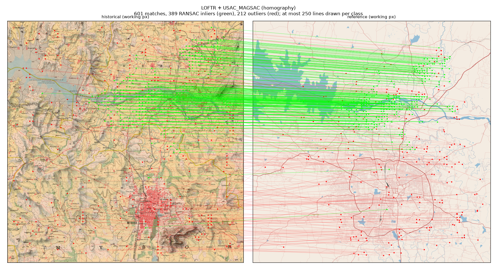
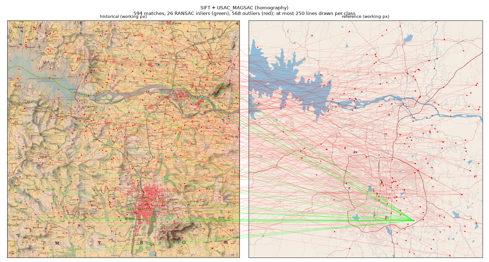
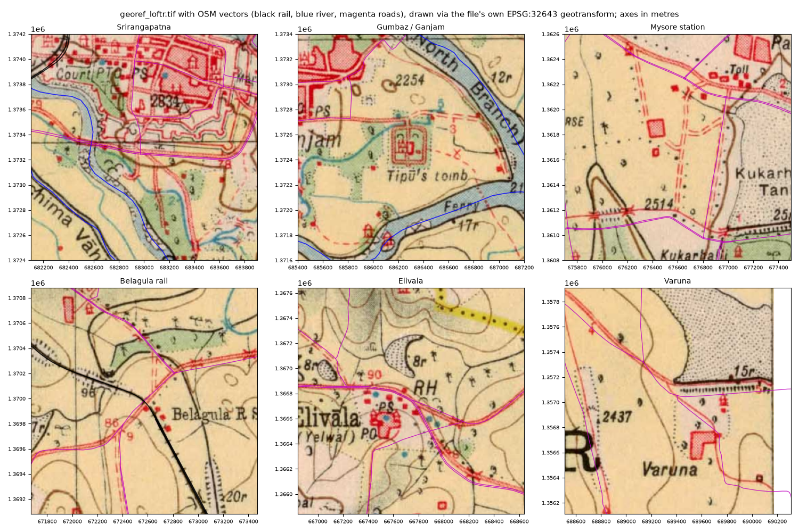
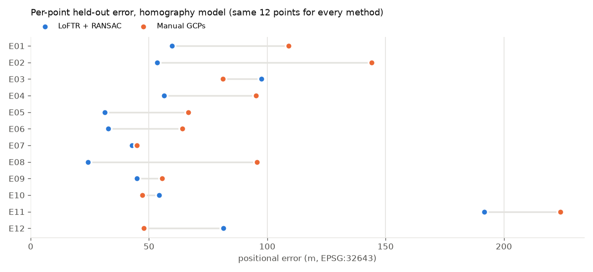
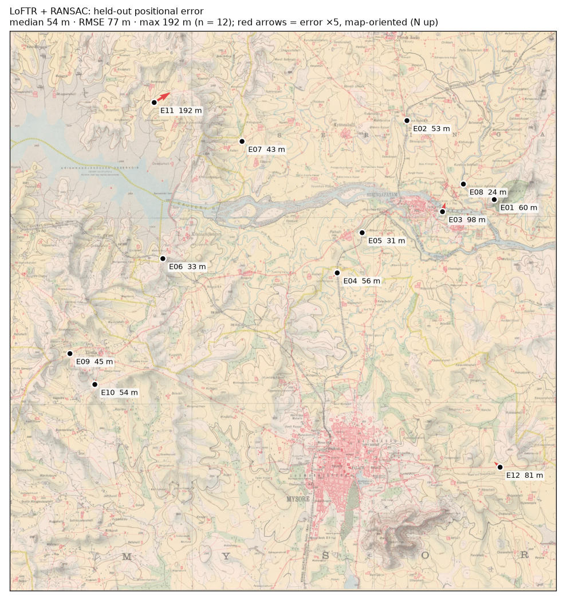

# Feature-Based Georeferencing of Historical Survey of India Maps: A Reproducible Baseline Comparison

*Technical report, MapAlign v0.1.0, 19 October 2026. Code, data provenance and all outputs:
this repository. Every number below is read from `results/`.*

> **Disclosure.** All ground-control points (9 for fitting, 12 for evaluation) were picked by an AI assistant
> (Claude) from zoomed image crops. They were then reviewed by the author (Saksham Sharma), who accepted every pick
> unchanged. Most of the code was also written with that assistant.

## Abstract

We compare three ways of georeferencing a scanned 1926 Survey of India one-inch sheet (57 D/11, Mysore) against
OpenStreetMap (OSM):
- learned matching (Kornia LoFTR + MAGSAC);
- classical matching (OpenCV SIFT + MAGSAC);
- a least-squares homography fitted to manually selected ground-control points (GCPs).

All three produce the same transform family. All are scored by one evaluation, as positional error in WGS 84 / UTM 43N
metres at held-out points whose truth is OSM vector geometry.

**SIFT failed.** Its matches between the 1926 lithograph and the OSM rendering were no better than chance, even on tiles
that were already aligned, so it produced no valid transform. **LoFTR** produced a valid transform (389 of 601 matches
were inliers). At 12 held-out points it reached a median error of 53.9 m and an RMSE of 77.4 m. The **7-point manual
fit** reached 73.9 m and 102.4 m. LoFTR was more accurate at 9 of 12 points (exact Wilcoxon p = 0.043; bootstrap 95 % CI
of the median paired difference [−44.0, +2.5] m). An affine model performed about the same as the homography.

The evidence is limited:
- one sheet;
- 12 rather than the planned 20 evaluation points, with no coverage in the south;
- AI-picked control points that were human-reviewed but not independently re-picked.

## 1. Introduction and motivation

Large collections of Survey of India sheets from the 1880s–1960s are now openly available as scans. To be used
alongside modern data, a sheet must first be georeferenced, that is, related to a geographic coordinate system.
Doing this by hand requires control points that are identifiable on both a century-old map and a modern reference.
That is laborious, and on a changing landscape it is not always possible.

Dense learned matchers such as LoFTR [1] can find correspondences in low-texture image pairs where detector-based
methods such as SIFT [2] struggle. A historical topographic map and a modern map rendering differ in style, symbols,
colour and content, so it is an empirical question whether either kind of matcher transfers to this setting.

This report does not propose a new method. It measures three baselines under one fixed, documented protocol and
reports where and why they fail.

## 2. Dataset and geographic reference

**Historical map.** Sheet 57 D/11 "Mysore", Mysore District. Surveyed in season 1924–25 and published 1926 under
Col. C. P. Gunter, Officiating Surveyor General of India. Scale 1:63,360 (one inch to a mile), contours at 50 ft.
It comes from the Old Survey of India Maps collection on Zenodo [8] (record 8388121, CC BY 4.0).
- *File:* 5898 × 6828 px, 300 dpi JPEG; MD5 matches Zenodo; SHA-256 `c308d1f4…167c13`.
- *Neatline:* 76°30′–76°45′E, 12°15′–12°30′N.
- *Grid:* a graticule with ticks every 5′ and no projected grid.
- *Content:* the Cauvery corridor, Srirangapatna, three railway lines and Mysore city. The Krishnarajasagara dam was
  still under construction.

The sheet was chosen from three verified Karnataka candidates (`data/SOURCES.md`) because its scan is clean and many
of its features survive today.

**Modern reference.** OSM features were downloaded with one Overpass API query covering the sheet plus a 0.03° margin
(snapshot 2026-10-18T18:43Z; 32,355 ways). They include roads, railways, waterways, water bodies and places. The features
were rendered by our own code into a GeoTIFF in EPSG:32643 at 5 m/px (6785 × 6900 px), with an exact north-up affine
geotransform. The style loosely imitates the 1926 palette (red roads, black railways, blue water). Rendering it
ourselves, instead of using web tiles, gives a known pixel-to-metre mapping and respects the OSM tile policy.

**CRS and datum.** Positional errors are computed in WGS 84 / UTM zone 43N. At this latitude the UTM scale distortion
is negligible: 0.08 m over 10 km compared with geodesic distance. The sheet's graticule is on a pre-WGS84 Indian
(Kalianpur) datum that we have not identified. PROJ offers no real Kalianpur 1880 → WGS84 transformation. We therefore
never use the printed coordinates as truth (Section 4).

## 3. Methodology

**Coordinate chain.** All methods estimate one 3 × 3 matrix *H* that maps historical-scan pixels to reference-raster
pixels. The reference geotransform then maps pixels to EPSG:32643 metres.
- Pixel coordinates follow the OpenCV pixel-centre convention, in the original full-resolution files.
- Working-resolution coordinates are converted with explicit matrices, which are tested against `cv2.resize`.

**Preprocessing.**
- The scan is cropped to its neatline. The four corner pixels were picked by eye and then refined to the darkest line
  pixel.
- Both images are resampled to a common nominal 10 m/px and converted to grayscale.

**Method A: LoFTR.** We use Kornia's [5] `LoFTR(pretrained="outdoor")` in evaluation mode without gradients.
- *Input size:* the coarse stage's memory grows with the product of the two image areas, so the full sheet cannot be
  matched at 10 m/px. Both images are scaled by a single common factor so the longer side is ≤ 768 px (≈ 45 m/px), which
  keeps their ground resolutions equal.
- *Confidence:* all matches are kept regardless of confidence.

**Method B: SIFT.**
- OpenCV SIFT with default parameters on the 10 m/px images.
- Brute-force L2 two-nearest-neighbour matching, then Lowe's ratio test at 0.75 [2].

**Shared robust estimation.** Both automatic methods use OpenCV's USAC MAGSAC++ [4] (a RANSAC variant [3]):
- threshold of 3 px at the resolution where the matcher located the points (30 m for SIFT, ≈ 135 m for LoFTR);
- 1.2 × 10⁶ maximum iterations, enough for 99.9 % confidence at a 5 % inlier ratio;
- seed 42.

A transform is accepted only if it passes checks for finite entries, conditioning, orientation, anisotropy, corners
past the horizon line, convexity of the mapped outline, and plausible bounds. If it fails, the method is recorded as
failed; it is never silently repaired.

**Method C: manual GCPs.**
- *Candidates:* computed from OSM vector geometry, for example the exact intersection of a railway and a road.
- *Picking:* the corresponding 1926 pixel was picked from zoomed crops. The crops were centred using only the printed
  sheet corners, so no method's transform could bias the picking.
- *QC:* a pre-fit rule removed 2 of 9 points (Section 4).
- *Fit:* a least-squares homography on the remaining 7, the same family as Methods A and B (Hartley & Zisserman [6]).

**Georeferenced output.** A homography cannot be stored as a GeoTIFF affine geotransform. We therefore resample the
scan onto a north-up EPSG:32643 grid at 5 m. Each output pixel is mapped back to the scan through the *exact* inverse
chain (output px → metres → reference px → H⁻¹ → scan px). The only approximation is bilinear interpolation, and a unit
test confirms the inverse mapping to within 0.02 of a pixel value.

## 4. Experimental protocol

**Development vs evaluation.** All settings changed during development were justified without evaluation data and
frozen in `configs/experiment.yaml` on 19 Oct 2026, before any evaluation point existed. Development checks used only a
*graticule prior*: the homography defined by the four printed corners, with their printed coordinates treated as WGS84.
It is accurate to a few hundred metres.

Three settings changed from their initial values:
1. **LoFTR input size, 1280 → 768 px.** The criterion was fixed before the sweep: the most matches within 1 km of the
   prior. At 1280 px only 7 % of matches were prior-consistent; at 768 px, 71 %.
2. **RANSAC iterations, 10⁴ → 1.2 × 10⁶,** from the standard sample-count formula.
3. **Threshold rule:** "3 px at the matcher's resolution" instead of a fixed 3 working px.

SIFT was given eight preprocessing variants, and the same RANSAC settings, for parity. None helped, so its predefined
parameters were left unchanged.

**Control points.** The protocol (`gcp/PROTOCOL.md`) was written before picking began.
- *Acceptance:* a feature must exist in 1926 with the same geometry and be locatable to about ±5 px (±27 m).
- *Spatial design:* a 5 × 5 grid over the sheet. Evaluation points must lie ≥ 1 km from every fitting point.
- *QC:* both sets pass a method-independent check, where a point is flagged if its offset from the graticule prior is
  more than 3 robust σ from the median.
  - On the fitting set it removed F02 (≈ 500 m off, a realigned road) and F05.
  - On the evaluation set it caught two of the assistant's picking errors (a wrong road, and a position that had been
    extrapolated rather than read). Both were re-examined; none was dropped.
- *Lock:* the evaluation file was locked by SHA-256 before any prediction was computed, and the evaluation code
  refuses to run if the file changes.

**Shortfall.** Only 12 evaluation points could be established, not 20. Most candidates were rejected:
- post-1926 features (the Varuna canal network, ring roads);
- realignment: the city section of the Mysore–Nanjangud railway lies about 280 m from its 1926 course, consistent with
  gauge conversion;
- ambiguous junctions.

No evaluation point lies in the southern fifth of the sheet or in Mysore city.

**Metrics.** For point *i*, eᵢ = √((Eᵢ − Êᵢ)² + (Nᵢ − N̂ᵢ)²) in metres. We report mean, median, RMSE, max, min,
population standard deviation and 90th percentile.

The methods are compared paired, on the same points:
- an exact two-sided Wilcoxon signed-rank test [7];
- a percentile-bootstrap 95 % CI for the median paired difference (20,000 resamples).

With n = 12 both are low-powered and are reported as descriptive.

## 5. Quantitative results

**Table 1.** Held-out positional error (m), homography model, 12 points.

| Method | Transform | n | Median | Mean | RMSE | Max | Min | Std | P90 | CPU time |
|---|---|---|---|---|---|---|---|---|---|---|
| SIFT + MAGSAC | **failed** (594 matches; 26 inliers, degenerate) | 0 | – | – | – | – | – | – | – | ≈ 15 s |
| LoFTR + MAGSAC | valid (601 matches; 389 inliers, 64.7 %) | 12 | **53.9** | **64.2** | **77.4** | 191.7 | 24.2 | 43.3 | 95.9 | ≈ 20 s |
| Manual GCPs | valid (7 points) | 12 | 73.9 | 89.6 | 102.4 | 223.9 | 44.9 | 49.5 | 140.6 | 0.15 s* |

\* Fitting time only. Human interaction time is not applicable: the points were AI-picked and only reviewed by a human.
CPU: AMD Ryzen 7 5800HS, PyTorch 2.14.1 (CPU build).

**Paired comparison.** LoFTR was more accurate at 9 of 12 points. The median paired difference (LoFTR − manual) was
−31.7 m; exact Wilcoxon p = 0.043; bootstrap 95 % CI [−44.0, +2.5] m. The CI includes zero, so the advantage is
suggestive, not established.

**Three kinds of error, kept apart:**

| Error type | What it measures | Value |
|---|---|---|
| Fitting error | Method C residuals at its own 7 fitting points | RMSE 55.6 m (leave-one-out RMSE 146.9 m) |
| Automatic-match reprojection error | Image-space RMSE of LoFTR's inliers | 6.4 working px (≈ 64 m) |
| **Positional error** | Distance from truth at held-out points (Table 1) | primary result |

**Affine vs homography** (secondary; not used to select anything):

| Method | Model | Median | RMSE |
|---|---|---|---|
| LoFTR | affine | 42.4 m | 76.3 m |
| LoFTR | homography | 53.9 m | 77.4 m |
| Manual | affine | 87.8 m | 105.5 m |
| Manual | homography | 73.9 m | 102.4 m |

The projective terms give no measurable gain. With only 7 fitting points, the manual homography's two extra degrees of
freedom are poorly constrained, which matches its large leave-one-out error.

**Sensitivity.** Without the three low-confidence points (n = 9):

| Method | Median | RMSE |
|---|---|---|
| LoFTR | 44.9 m | 46.0 m |
| Manual | 66.7 m | 86.1 m |

These figures are context only; they do not replace Table 1.

## 6. Qualitative results

*Figure 1. LoFTR correspondences. Green: RANSAC inliers. Red: outliers. Inliers concentrate along the Cauvery corridor
and the railways in the northern half of the sheet. The Mysore city area contributes mostly outliers.*

*Figure 2. SIFT correspondences: 594 ratio-test matches with no consistent geometry.*

*Figure 3. OSM railways, rivers and roads drawn on the LoFTR GeoTIFF, using only the file's own EPSG:32643
geotransform. They fall on the 1926 linework to within tens of metres, including at Mysore station, which no method
was fitted on.*

The GeoTIFFs were also checked at the file level. At 2,000 random points, reading the GeoTIFF at its own predicted
coordinate returns the source scan pixel (mean colour difference 4.6). Shifting the lookup by 10 m raises it to 14.8,
so the check is sensitive. A visual check in QGIS was not carried out.

## 7. Error analysis

*Figure 4. Per-point held-out errors for LoFTR (blue) and the manual fit (orange).*

*Figure 5. LoFTR error vectors (×5, north up).*

**Why SIFT fails.** Even when tiles are pre-aligned by the graticule prior, only 4.75 % of SIFT ratio-test matches lie
within 600 m of the correct position, against a chance rate of 4.31 %. LoFTR scores 12.9 % on the same test. SIFT's
gradient-histogram descriptors do not transfer between the hatched, hand-lettered 1926 lithograph and the flat vector
rendering. None of the variants changed this: CLAHE, colour-layer extraction, and 10–45 m resolution.

**LoFTR's scale sensitivity.** LoFTR's success depends strongly on scale, and not monotonically. The share of
prior-consistent matches was 59 % at 384 px, 79 % at 512 px, 61 % at 640 px, 71 % at 768 px and 7 % at 1280 px. A
different input size, chosen without the prior, could have produced a failure as complete as SIFT's.

**Spatial pattern.**
- The largest error, **E11** (192 m for LoFTR, 224 m for manual), occurs for *both* methods in the same direction. That points to a
  mis-identified evaluation point or a realigned road, not to either method. The point was marked low-confidence
  before evaluation.
- The manual fit's errors in the north-east point consistently south (E01, E02, E04, E08). This is consistent with a
  homography constrained by only 7 unevenly spread points, of which three are in the eastern third and none in the southern quarter except F09 in the far south-east.
- LoFTR's inliers are concentrated in the north. The southernmost evaluation point (E12, 81 m) is within the range of
  the others, but one point says little. Neither method can be assessed in the far south, where there are no
  evaluation points.

**Datum.** Measured at the fitting GCPs, true WGS84 positions are offset from the printed graticule by a median
(−84 m E, +53 m N); the robust σ is 58/95 m. LoFTR's correct matches imply a similar shift, (−128, +133) m. PROJ's
Kalianpur 1937 and 1975 parameters give (−23 to −118, +159) m at the sheet centre. All three agree in direction, which
supports a datum shift of roughly 100–200 m. The precise datum remains unidentified.

## 8. Limitations

- **Scope.** One sheet and one OSM rendering style. Conclusions are specific to this pair.
- **Control points.** All 21 GCPs were picked by an AI assistant and reviewed, unchanged, by the author. Method C is
  therefore "AI-picked, human-reviewed GCPs", not independent human georeferencing, and the evaluation truth inherits
  the same picking uncertainty
  (≈ ±27 m).
- **Truth.** OSM geometry is of unknown accuracy, plausibly 5–20 m.
- **Sample.** 12 evaluation points, with no coverage in the south or in Mysore city.
- **Development choices.** Three settings were changed after the first failures (Section 4). They were justified on
  development data and frozen before evaluation, but they remain post-hoc choices.
- **Not done.** QGIS verification; non-linear transforms; an independent human re-picking of the GCPs.

## 9. Conclusion

- **SIFT** did not work at all on this historical-to-modern pair, and the aligned-tile test shows why: its matches are
  at chance level.
- **LoFTR**, at a suitable input scale, produced a usable alignment. Its median held-out error was ≈ 54 m and its RMSE
  ≈ 77 m, which is about 1 mm at the 1:63,360 map scale.
- **The 7-point manual fit** was somewhat worse (median ≈ 74 m, RMSE ≈ 102 m).
- **Affine and homography** models performed alike.

The comparison favours LoFTR on this sheet, but with 12 points the evidence is weak.

The most valuable next steps:
1. independent human re-picking of the GCPs, including southern points, with the evaluation repeated as a
   documented revision;
2. more sheets;
3. local non-linear transforms to absorb paper distortion and datum effects.

## References

[1] J. Sun, Z. Shen, Y. Wang, H. Bao, X. Zhou. LoFTR: Detector-Free Local Feature Matching with Transformers. *CVPR*, 2021.
[2] D. G. Lowe. Distinctive Image Features from Scale-Invariant Keypoints. *International Journal of Computer Vision* 60(2):91–110, 2004.
[3] M. A. Fischler, R. C. Bolles. Random Sample Consensus: A Paradigm for Model Fitting with Applications to Image Analysis and Automated Cartography. *Communications of the ACM* 24(6):381–395, 1981.
[4] D. Barath, J. Noskova, M. Ivashechkin, J. Matas. MAGSAC++, a Fast, Reliable and Accurate Robust Estimator. *CVPR*, 2020.
[5] E. Riba, D. Mishkin, D. Ponsa, E. Rublee, G. Bradski. Kornia: an Open Source Differentiable Computer Vision Library for PyTorch. *WACV*, 2020.
[6] R. Hartley, A. Zisserman. *Multiple View Geometry in Computer Vision*, 2nd ed. Cambridge University Press, 2004.
[7] F. Wilcoxon. Individual Comparisons by Ranking Methods. *Biometrics Bulletin* 1(6):80–83, 1945.
[8] J. Brown. Old Survey of India Maps collection. Zenodo, doi:10.5281/zenodo.10519306 (sheet: record 8388121), CC BY 4.0.
[9] OpenStreetMap contributors. OpenStreetMap, https://www.openstreetmap.org, data under ODbL; Overpass snapshot 2026-10-18.
